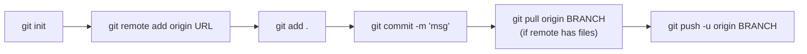

<div align="center">

# 🧰 Configs

**My personal cheat-sheet of setup commands — spin up Angular, React and Tailwind projects and get Git configured without searching the docs every time.**


</div>

---

## 📂 What's in here

| File | Covers |
|---|---|
| [`Angular.txt`](Angular.txt) | New project, modules, components and other CLI scaffolding |
| [`React.txt`](React.txt) | Create React App quick start |
| [`React-Vite.txt`](React-Vite.txt) | React + Vite quick start |
| [`TailwindCSS.txt`](TailwindCSS.txt) | Adding Tailwind to a project |
| [`TailwindCSS-Vite.txt`](TailwindCSS-Vite.txt) | Tailwind via the `@tailwindcss/vite` plugin |
| [`Git Config.txt`](Git%20Config.txt) | Connect a repo, first commit, branches, pull & upstream |

## ⚡ Quick reference

<details>
<summary><b>🅰️ Angular</b></summary>

```bash
npm install -g @angular/cli
ng new project_name
code .
ng serve                       # or: npm start

ng g m module_name             # module
ng g c compo_name              # component
```

More in [`Angular.txt`](Angular.txt).

</details>

<details>
<summary><b>⚛️ React (Vite)</b></summary>

```bash
npm create vite@latest my-react-app -- --template react
cd my-react-app
npm i
npm run dev
```

</details>

<details>
<summary><b>⚛️ React (Create React App)</b></summary>

```bash
npx create-react-app my-react-app
cd my-react-app
npm start
```

</details>

<details>
<summary><b>🎨 Tailwind CSS with Vite</b></summary>

```bash
npm install tailwindcss @tailwindcss/vite
```

```ts
// vite.config.ts
import { defineConfig } from 'vite'
import tailwindcss from '@tailwindcss/vite'

export default defineConfig({
  plugins: [tailwindcss()],
})
```

```css
/* your main CSS file */
@import "tailwindcss";
```

</details>

<details>
<summary><b>🌱 Git — first push</b></summary>



Full notes, including fixing upstream issues, in [`Git Config.txt`](Git%20Config.txt).

</details>

---

<div align="center">

Maintained by **[Shariq](https://github.com/Shariq2003)** · [LinkedIn](https://www.linkedin.com/in/shariq-sd)

</div>
